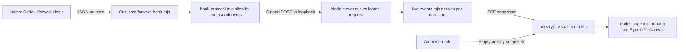

# Architecture

- **Hook input.** `Manage-Hooks.ps1` defines eight async command Hooks. The launcher uses an absolute, per-user runtime path. Codex passes its payload on stdin. The forwarder caps input at 1 MiB, emits neutral JSON and bounds its HTTP request to 230 ms. Codex applies the outer one-second Hook timeout.
- **Normalization and transport.** `hook-protocol.mjs` reduces the payload before transport. The server validates allowed fields, time, HMAC and delivery ID. The private HMAC key is generated on install and stays in the user runtime.
- **State.** The bridge derives current turns from received events, tracks unique tool edges by session/turn/call/type when a call ID exists, and keeps a 30-second tool-start window. HTTP delivery replay and tool-edge deduplication are separate. A turn with no terminal event eventually expires. No event replay survives a bridge restart.
- **View.** `/wallpaper` and `/` use same-origin `/events`. The browser receives an in-memory snapshot on connect. `activity.js` smooths rates and draws feedback. The Canvas source stays pinned, while `render-page.mjs` patches the served HTML in memory. Ambient mode renders without live event intake.

| Observed event | Visual meaning |
| --- | --- |
| `UserPromptSubmit` | Turn pulse and activation. |
| `PreModelRequest` / `PostModelRequest` | Model request in flight or finished, inferred from the received edges. A reported failed request can trigger a fault effect. |
| `PreToolUse` / `PostToolUse` | Tool beam and inferred tool activity. Call IDs enable deduplication and rate counting. |
| `PermissionRequest` | Short, inferred waiting indication. |
| `Stop` / `Interrupt` | Clear the matching turn. `Stop` can emit a completion wave. |

There is one Codex input adapter in v1.0.0. The normalization and view boundaries are useful places to evaluate additional adapters later. [Development](DEVELOPMENT.md) · [Known limitations](KNOWN_LIMITATIONS.md)
